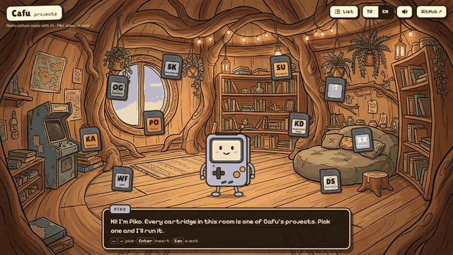
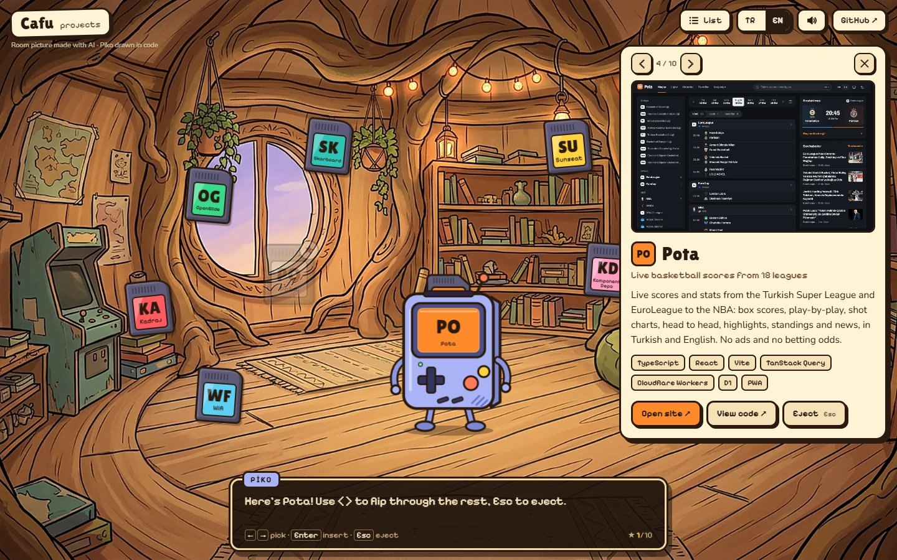
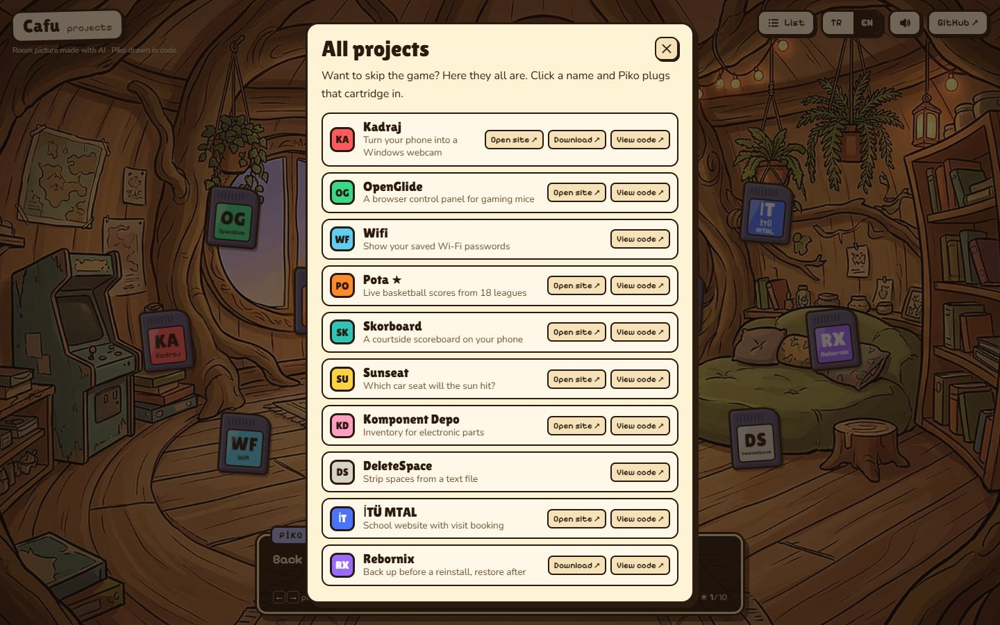
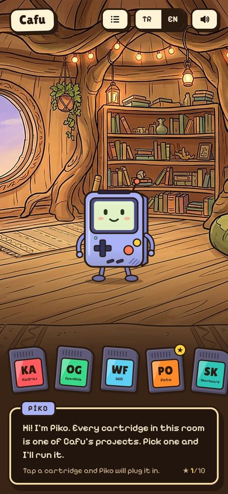

<p align="center">
  <a href="https://cafu1107.github.io"></a>
</p>

<h1 align="center">Cafu's Room</h1>

<p align="center">
  My portfolio as a little game. Every project is a cartridge in a cartoon treehouse, and Piko, a handheld console with a face, plugs it in and shows you what it does.
</p>

<p align="center">
  <a href="https://cafu1107.github.io"></a>
</p>

<p align="center">
  
  
  
  
</p>

<p align="center"><a href="#-türkçe">🇹🇷 Türkçe aşağıda</a></p>

---

## How to play

1. **Pick** a cartridge: point at it, or use <kbd>←</kbd> <kbd>→</kbd>. Piko looks at it and tells you what it is.
2. **Plug it in** with a click or <kbd>Enter</kbd>. The cartridge flies into Piko's slot, his screen boots, and the project card opens with a screenshot, a description and links to the live site, the download and the code.
3. **Flip** to the next project with <kbd>‹</kbd> <kbd>›</kbd> or the arrow keys, and **eject** with <kbd>Esc</kbd>.

On a phone, the cartridges sit on a shelf you can swipe; tap one to plug it in. Want to skip the game? **List** in the top bar shows every project on one page.

## What's in the room

| | |
|---|---|
| 🎮 **10 cartridges** | One per public project: Kadraj, OpenGlide, Pota, Sunseat, Skorboard, Komponent Depo, İTÜ MTAL, Rebornix, Wifi and DeleteSpace. |
| 🤖 **Piko** | Blinks, waves hello, follows the cartridge you point at, reacts when you poke him and suggests a project if you go quiet. |
| 🔊 **Sound** | Every blip, click and boot jingle is synthesized live with the Web Audio API. There are no audio files, and the mute button remembers your choice. |
| ⭐ **Progress** | Cartridges you have played get a star sticker, and the dialog box counts how many you have seen. |
| 🌍 **Two languages** | English and Turkish, picked from your browser and switchable in the top bar. |
| ♿ **Accessible** | Full keyboard play, labelled controls and a spoken dialog for screen readers. With reduced motion turned on, the animations are skipped. |

## Screenshots

| Project card | All projects | Phone |
|---|---|---|
|  |  |  |

## How it's made

- **One HTML file, no framework, no build step.** `portfolyo.html` holds the page, the styles and the script. `index.html` is the same page wrapped with the `<head>` tags GitHub Pages needs (title, social preview, favicon).
- **Piko** is an inline SVG drawn by hand in code, so his face, screen and cartridge slot can change while you play.
- **The room** is a single illustration generated with AI (Higgsfield, Nano Banana) and then sharpened. The project screenshots are taken from the live sites.

<details>
<summary><b>For developers</b></summary>

```sh
git clone https://github.com/Cafu1107/Cafu1107.github.io
cd Cafu1107.github.io
sh index-olustur.sh          # rebuild index.html after editing portfolyo.html
python -m http.server 8000   # then open http://localhost:8000
```

To add a project, add an entry to the `PROJECTS` array in `portfolyo.html` (name, two-letter monogram, colour, position in the room, English and Turkish text, links) and put a 1000×625 screenshot in `gorseller/`.

</details>

## License

The code is [MIT](LICENSE). The room illustration was made for this site.

---

## 🇹🇷 Türkçe

**Cafu'nun Odası**, portfolyomun küçük bir oyun hâli. Her proje, çizgi film tarzı bir ağaç evde duran bir kartuş. Yüzü olan bir el konsolu olan Piko kartuşu takıyor ve projenin ne yaptığını gösteriyor.

**[cafu1107.github.io adresinden oyna →](https://cafu1107.github.io)**

### Nasıl oynanır

1. Bir kartuş **seç**: üzerine gel ya da <kbd>←</kbd> <kbd>→</kbd> tuşlarını kullan. Piko kartuşa bakıp ne olduğunu söyler.
2. Tıklayarak ya da <kbd>Enter</kbd> ile **tak**. Kartuş Piko'nun yuvasına uçar, ekranı açılır ve proje kartı gelir: ekran görüntüsü, açıklama, canlı site, indirme ve kod linkleri.
3. <kbd>‹</kbd> <kbd>›</kbd> ya da ok tuşlarıyla sonraki projeye **geç**, <kbd>Esc</kbd> ile **çıkar**.

Telefonda kartuşlar kaydırılabilir bir rafta durur; birine dokunman yeterli. Oyunla uğraşmak istemezsen üst çubuktaki **Liste** bütün projeleri tek sayfada gösterir.

### Odada neler var

- 🎮 **10 kartuş:** Kadraj, OpenGlide, Pota, Sunseat, Skorboard, Komponent Depo, İTÜ MTAL, Rebornix, Wifi ve DeleteSpace.
- 🤖 **Piko:** Göz kırpar, el sallar, gösterdiğin kartuşa bakar, dürtünce tepki verir, bir süre bir şey yapmazsan sana proje önerir.
- 🔊 **Ses:** Bütün sesler Web Audio API ile anında üretilir, hiç ses dosyası yok. Sesi kapatma tercihin hatırlanır.
- ⭐ **İlerleme:** Oynadığın kartuşlara yıldız çıkartması yapışır, konuşma kutusu kaç tanesini gördüğünü sayar.
- 🌍 **İki dil:** İngilizce ve Türkçe; tarayıcının diline göre açılır, üst çubuktan değiştirilir.
- ♿ **Erişilebilir:** Tamamen klavyeyle oynanır, ekran okuyucular için etiketler ve sesli okunan konuşma kutusu var. Azaltılmış hareket ayarı açıksa animasyonlar atlanır.

### Nasıl yapıldı

Tek bir HTML dosyası; framework ve derleme adımı yok. Piko kodla çizilmiş bir SVG, oda görseli yapay zekâ ile (Higgsfield, Nano Banana) üretildi. Proje ekran görüntüleri canlı sitelerden alındı. Kod [MIT](LICENSE) lisanslı.
